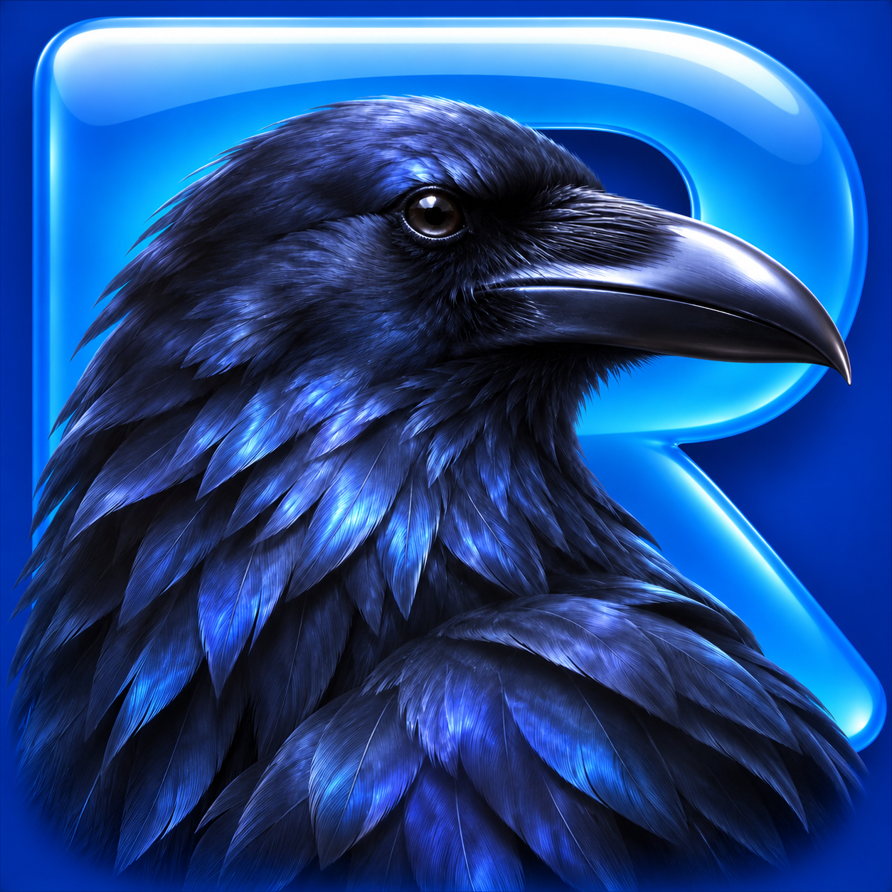

# Nevermore



A native Swift/AppKit macOS client for [Raven](https://github.com/frappe/raven).

Nevermore uses native windows, menus and text editing, a selectable conversation transcript, browser OAuth, account-isolated local storage, durable drafts/outbox, Socket.IO and authenticated file previews. Keyboard conversation/mention completion, native thread inspectors, server collections, account preferences, window restoration, a native code reader, file-promise imports and save-before-Quit are included. No Electron, Catalyst or web-based chat interface.

The app is an early implementation. **It is not a validated 1.0 release.** Real Raven/Frappe deployment testing and production distribution gates are recorded separately from local tests. Notifications work only while Nevermore is running; sleep and Quit interrupt this path.

## Download

Signed, notarized builds are on [apps.goodvantage.cloud](https://apps.goodvantage.cloud/#nevermore). Nevermore checks for newer releases after launch and daily. Prerelease builds check the beta channel; other builds check stable. The sidebar, application menu and optional menu bar item show an available update, with at most one system notification attempt per version. You can dismiss that version or open its download in your browser and install it yourself. Nevermore never replaces itself.

Use **Nevermore → Check for Updates…** for a manual check, including when automatic checks are off. Turn automatic checks off in **Settings → General**. Checks contain no Raven credentials or account data. Demos and automated fixtures do not check automatically.

## Build and run

Requires macOS 26 (Tahoe) or later and a Swift 6.2 toolchain (Xcode 26 or later). Open `Package.swift` in Xcode, or:

```sh
swift test --triple "$(uname -m)-apple-macosx26.0"
./scripts/build-app.sh
open build/Nevermore.app
```

The packaging script uses an installed Apple Development signing identity. With several, it signs with the one whose name sorts first byte by byte (uppercase before lowercase, whatever your locale) and lists them all. Set `SIGN_IDENTITY` to a SHA-1 hash from `security find-identity -v -p codesigning` to choose another. For an isolated local demonstration without a Raven account:

```sh
open build/Nevermore.app --args --demo
```

Pick a theme in Settings ▸ Appearance or View ▸ Theme. The themes are presets: Customize Theme… changes the active one's colors, backdrop, wallpaper and fonts, and Settings ▸ Appearance has a backdrop opacity slider for all themes. To review theme art without running the app, `swift run --triple "$(uname -m)-apple-macosx26.0" Nevermore --theme-art-sheet /tmp/nevermore-art` writes contact sheets of every motif and ornament plus a poster per theme.

For a real account, create a **separate public OAuth Client** on your Frappe site with exact redirect `ch.goodvantage.Nevermore://oauth`, authorization-code flow and S256 PKCE. Enter the HTTPS site origin and client ID in Add Account. Once the site address is entered, Add Account links to the site's OAuth Client list (`/desk/integrations/oauth-client`) so you can look the ID up with one click. The Client ID field starts with a preset ID that fits only the site it was registered on: replace it for any other site. Do not reuse/modify Raven Mobile's registration, and do not embed a client secret. See [setup, recovery and distribution](docs/implementation/OPERATIONS.md).

## Message formatting

Use the composer toolbar or Format menu for text styles, lists, quotes, code,
links and horizontal rules. Choose the table button to insert a table, or place
the caret in an existing table and choose it to edit cells and rows/columns.
Merged-cell text is editable; row/column changes require an unmerged table.

Choose **Markdown…** for the expanded editor, then switch between **Visual** and
**Markdown**. The Markdown surface uses Top Drawer's native
[swift-markdown-engine](https://github.com/nodes-app/swift-markdown-engine), pinned
to 0.14.0. Mentions, custom emoji, spoilers and other formatting without a lossless
Markdown spelling remain HTML in source mode. No WebView or remote editor is used.

**Use Text** applies the result to your draft as one undoable change; **Cancel**
leaves it alone. Switching modes resets the expanded editor's undo history.
Unapplied sheet edits are in memory, not autosaved; finish or cancel before
quitting. Attachments stay in the main composer. See the
[formatting contract and limits](docs/implementation/COMPOSER-FORMATTING.md).

## Documentation

- [Product and engineering plan](docs/NEVERMORE-PLAN.md)
- [Pinned Raven/Frappe protocol research](docs/RAVEN-RESEARCH.md)
- [Implementation decisions](docs/implementation/DECISIONS.md)
- [Feature inventory and release boundaries](docs/implementation/FEATURES.md)
- [Validation evidence and remaining gates](docs/implementation/VALIDATION.md)

The research snapshot is **7 November 2026**. Source inspection and synthetic tests do not substitute for a running Raven deployment. The read-only [contract probe](scripts/check-live-contracts.py) supports private, authenticated deployment checks without logging credentials or message content.

## Artwork and licenses

The owner's [original app artwork](assets/AppIcon-original.png) is preserved unchanged. App icon resources are in [Resources](Resources); regenerate them with `./scripts/generate-app-icon.sh`.

Nevermore's source uses the [Unlicense](LICENSE). Raven is AGPL-3.0-only; this is an independent protocol implementation and does not copy Raven's application source or artwork. Dependency license texts ship in [Resources/Licenses](Resources/Licenses). No telemetry, Spotlight indexing or mandatory Nevermore-operated relay is included.

LLM disclosure: This codebase was written with substantial help from large language models: AI coding agents working from the [`AGENTS.md`](AGENTS.md) brief in this repo.
