# Home: replacing the empty conversation pane

Status: design exploration, 15 November 2026. Design B was chosen and built;
see §6.

When no conversation is selected, Nevermore shows the theme's motif, a themed
title such as "ＡＥＳＴＨＥＴＩＣ ＳＩＬＥＮＣＥ" and "Choose a conversation in the
sidebar, or press ⌘O." It tells you nothing you need. This note proposes a
Home pane in its place: what other apps do, what Home could show, what Raven
can supply for each item, and four design directions with mockups.

Decision already taken: Home never shows the per-theme empty titles
(`Theme.emptyTitle` in `ThemeCatalog.swift`). They read like the theme's name
and confuse more than they charm. Home uses one raven line and the app's own
raven figure (`RavenGlyph.swift`) in every theme; only the colours follow the
theme.

## 1. What other apps do

| App | What the start or home screen shows | Job |
| --- | --- | --- |
| Slack | Since the 2023 redesign: Home (all conversations), DMs, Activity (mentions, reactions, threads), Later (saved items and reminders, marked in progress or done). An Unreads view with sort and filter on desktop. Catch up (2024, mobile): unreads one card at a time, swipe to mark read or skip. Recap (Slack AI, 2024): a daily AI digest of chosen channels | Triage, saved queue, AI digest |
| Microsoft Teams | Activity feed. Discover feed (2024): a personalised feed of channel posts. Users asked for a way to turn it off; Microsoft later added a Show/Hide setting | Triage, discovery |
| Zulip | Configurable home view: Inbox, Recent conversations or Combined feed, set by the organisation and overridable per user. Its docs recommend Inbox for people who clear unreads and Recent conversations for an overview | Triage, re-entry |
| Google Chat | Home: one list of DMs, spaces and followed threads, with Unread and Threads filters (2023 to 2024) | Triage |
| Mattermost | Insights (v7.1, 2022): top channels, threads and reactions. Later removed as deprecated | Team analytics |
| Rocket.Chat | Admin-configurable home page (title and custom content) | Announcements |
| Discord | Friends home with an Active Now panel (what friends are doing). Many users asked to opt out on privacy grounds. Checkpoint (December 2025): a Wrapped-style year recap with messages sent, top emoji, top server and most-talked-to friend | Social awareness, reflection |
| Raven web and mobile | No home pane. The web main area shows the open channel; the mobile Home tab is the channel list | None |
| Telegram, WhatsApp, Signal, Messages | Logo and "select a chat" | None (the problem we have) |
| Safari Start Page | Favorites, Frequently Visited, Privacy Report, Reading List, iCloud Tabs, background image. Each section can be shown, hidden and reordered | Re-entry, quick actions, a little reflection |
| Superhuman | Inbox Zero shows a photo as a reward, only reachable by emptying the inbox | Reward for finishing |
| Linear | Pulse (2025): a personal feed of project updates, readable or as a short audio digest | Digest |
| Basecamp | Home: pinned projects, your schedule, your assignments | Re-entry |
| Notion | Home: recently visited, upcoming events, chosen widgets | Re-entry |
| Beeper | One inbox across networks, built around inbox zero with archive and low priority | Triage |

What this teaches:

1. **Triage is the main job.** The successful patterns (Slack Unreads and
   Catch up, Zulip Inbox, Google Chat Home) answer "what needs me, and what did
   I miss?" first.
2. **Make it optional and configurable.** Feeds pushed on people draw backlash:
   Teams added a way to hide Discover after users asked, and GitHub's 2022
   "For you" feed prompted extensions that remove it. Zulip and Safari let
   people choose what Home is.
3. **Statistics about people are risky.** Microsoft removed user names from
   Productivity Score in December 2020 after it was called a workplace
   surveillance tool. Discord's Active Now drew requests for an opt-out.
   Statistics about your own behaviour (Wrapped, Checkpoint, Screen Time) are
   accepted, and the "only you can see this" framing matters.
4. **Reward the empty state.** Superhuman's Inbox Zero photo shows that "you
   are done" can be a pleasure rather than a blank.

## 2. What Home could show

Cost is what a Home refresh adds to `AccountSession.refresh()`, which already
fetches the channel list, unread counts, notification IDs, active users and the
user directory. Verified against `Sources/` and Raven `v3.2.0`, `main` and
`develop`.

| Item | Data source | Cost | Privacy |
| --- | --- | --- | --- |
| Unread conversations with a preview | Unread counts already fetched. `get_all_channels` already returns `last_message_details` (plain-text `content`, `owner`, `message_type`) and `last_message_timestamp` in the raw channel JSON Nevermore keeps | **Free.** The preview is the latest message, not the first unread; DM events carry it live, channel events do not (refresh the list) | Server derives `content` with spoilers masked |
| Mentions and reactions | `notifications.get_unread_notification_message_ids` already fetched; one `get_notifications` page for text | Free to 1 request | Separate from channel read state |
| Thread replies waiting | `threads.get_unread_threads` | 1 request, response not yet modelled | |
| Reminders due today, saved messages | `reminders.get_reminders`, `raven_message.get_saved_messages` (already used by Later) | 2 requests | |
| Scheduled messages | `scheduled_message.get_scheduled_messages` | 1 request | |
| Drafts and unsent messages | Local `drafts` and `operations` tables | Free; needs a list-all-drafts query | Local only |
| Favorites | `pinned_channels` on the current user | Free | |
| Who is around, statuses | `get_active_users`, directory `custom_status` and `availability_status` | Free | Raven has no "last seen"; do not invent one |
| Recently active channels | `last_message_timestamp` | Free | |
| Public channels you have not joined | Channel list plus `ChannelPolicy.canJoin` | Free | "New" can only be a local guess |
| People you talk with most | Your own messages of the last 30 days in direct messages (see Your week), topped up with recently active direct messages | 1 request, shared with Your week | Your own behaviour; label it so |
| Your week: messages sent, busiest hour | `frappe.client.get_list` on Raven Message: Raven's `raven_message_query` limits list reads to the caller's own rows, so it returns your messages from every device | 1 request | Computed on this Mac; never uploaded |
| Your most-used reactions | `reactions.most_used_reactions` (already used for quick reactions) | Free | Your own data |
| Files shared today | One `search.sqlite_search` for files and images | 1 request | Index can lag; capped at 100 |
| Open polls you have not voted in | Search for polls, then `get_poll` each | Costly (1 + N) | Never expose anonymous voters |
| Pinned messages in favorites | `get_pinned_messages` per favorite | Costly (one per favorite) | |
| Account status (connected, offline) | Local session state | Free | Keep accounts separate |
| AI summary of unreads | No Raven API. `PRIVACY.md` says no message content is sent to an AI service | Not possible without a server change and a privacy decision | |

Not shown, on purpose: other people's response times, who read what, last-seen
times, rankings of colleagues. Raven's read receipts exclude hidden readers by
design, and Home must not rebuild that information from other endpoints.

Rules every design follows:

- Showing Home never marks anything read. Previews come from the channel list
  or `update_last_visit=false`, as `RAVEN-RESEARCH.md` §7 requires.
- Muted and archived conversations follow `AttentionPolicy`: a muted channel
  appears as one quiet line, not as news.
- Personal statistics say "only you see this", can be hidden, and are never
  coloured as good or bad. `PRIVACY.md` would gain a line about them.
- Each window's Home belongs to that window's account.
- Everything is reachable by keyboard and VoiceOver; nothing depends on motion.
- Home is a sidebar row at the top (Go ▸ Home, ⌘0), so you can come back to it.

## 3. Four designs

All mockups are 1280 × 800 points with fictional people. Sources are in
[`mockups/`](mockups/); `render.sh <file> theme=<id> <out.png>` renders one
with the headless Chromium from Playwright's cache.

### A. Catch Up: triage first

One reading column: **Waiting on you** (mentions, DMs, thread replies; each
with Reply, Mark Read and Later on hover or by key), **New in your channels**
(one line per channel with the latest message; muted channels collapse into a
single line), **Later today** (reminders and scheduled sends). A key hint bar
teaches ↑ ↓ ↩ E L. Precedents: Slack Unreads and Catch up, Zulip Inbox.

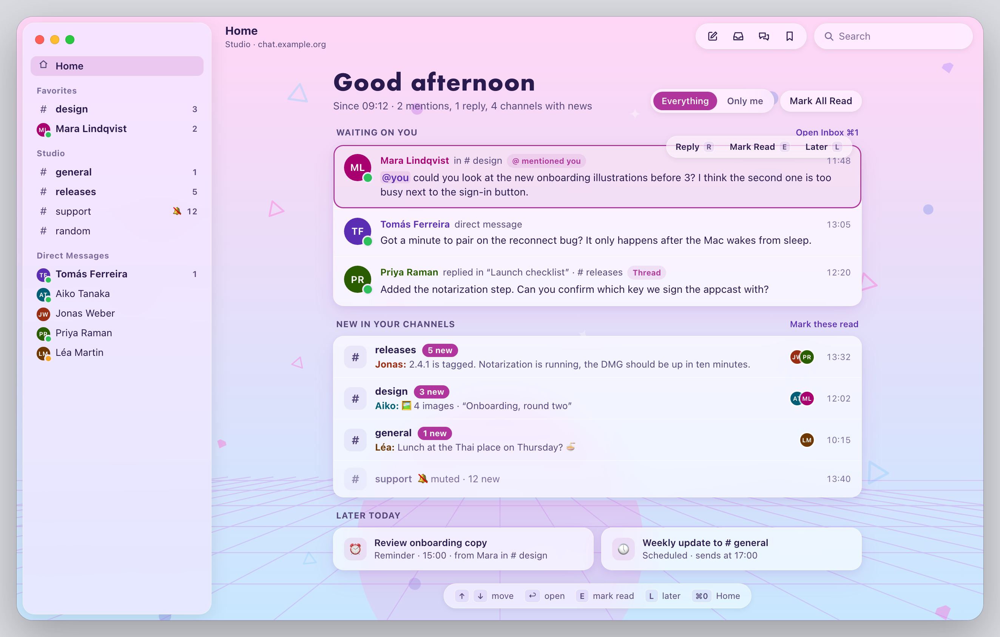
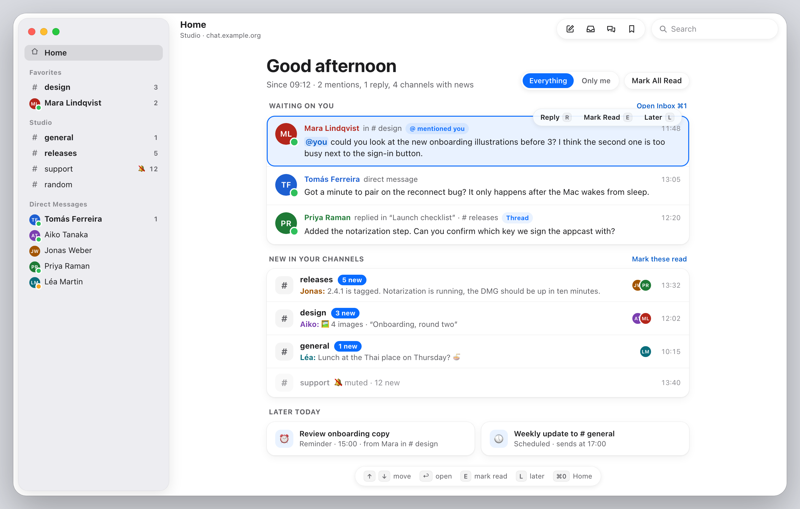

When nothing is left, the ravens rest on a wire in front of the moon: "Nothing
more. You're all caught up. The ravens are resting." Below: what is next, what
is unfinished, who is around. The sidebar's unread ravens have, in effect, come
home.

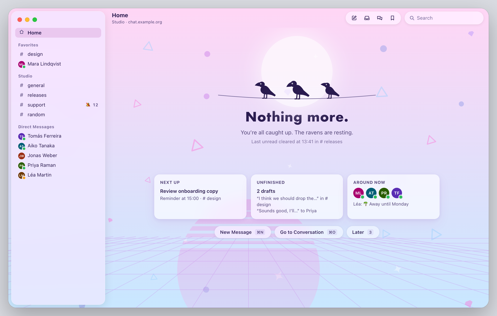
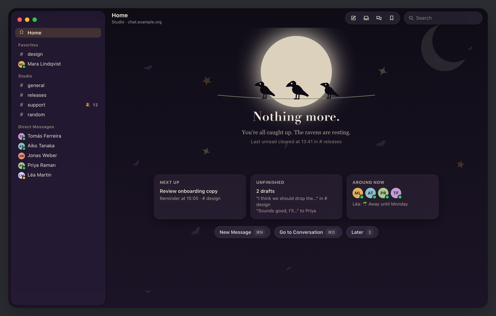

- For: the most useful on a working day; nearly all of its data is free; it
  brings Inbox, Threads and Later (separate windows today) into one place.
- Against: little for the user who wants an overview or a bit of play.

### B. Start Page: modules you choose

Modelled on Safari's Start Page. Favorites as large tiles with unread badges,
then modules: Unread, Later (reminders, saved, drafts, outbox), You talk with
most, Your week, Threads you follow, Shared today. The slider button opens
Customize Home: show, hide and reorder modules, and turn the theme backdrop on
or off.

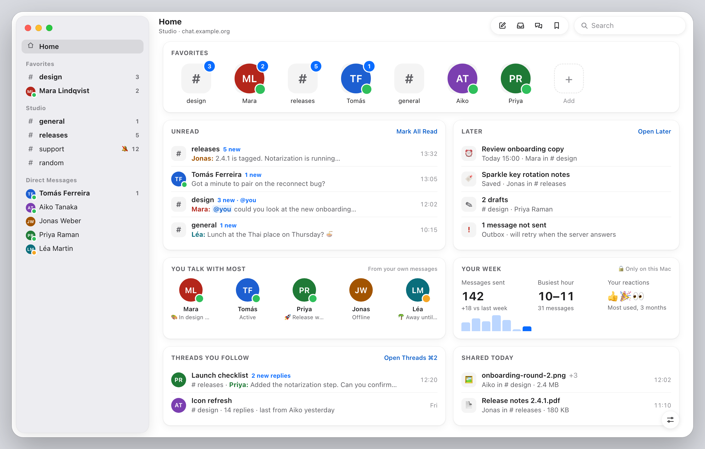
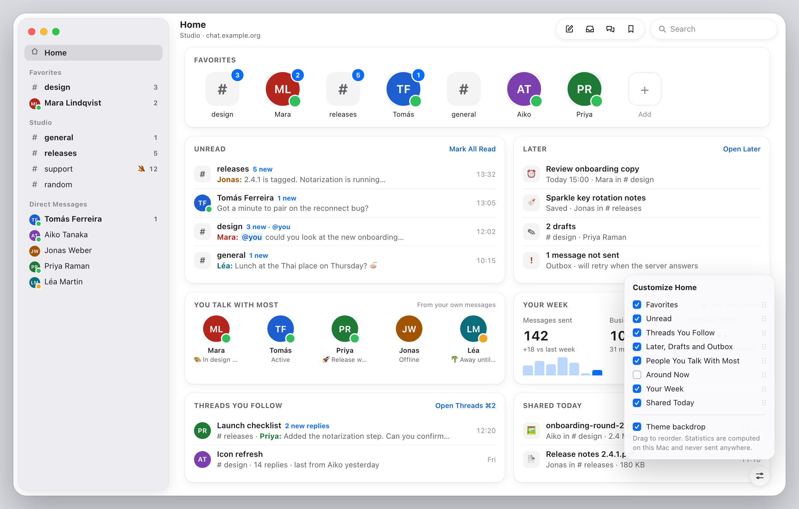
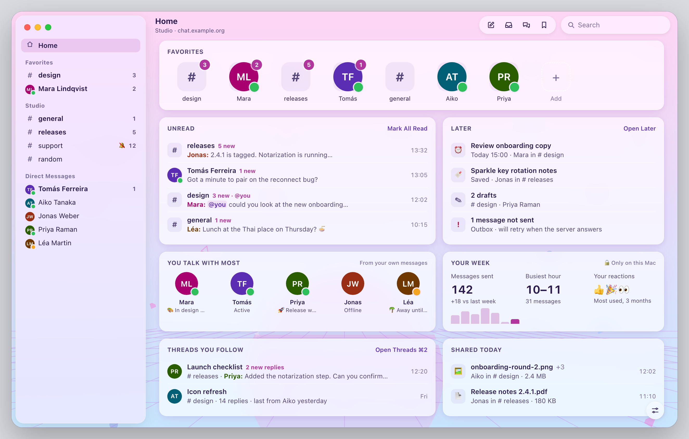

- For: covers the statistics and people ideas; each user picks their own
  balance; precedent people like.
- Against: the most to build; at the defaults it can feel like a dashboard
  (Slack's Home drew that criticism); needs a one-column layout below about
  900 points.

### C. Launcher: where to?

A keyboard-first pane: a large Go To field (⌘O moves here instead of a sheet),
then "Pick up where you left off": conversations with news, drafts and recent
conversations, the first one selected so Return opens it. Buttons for New
Message, Inbox, Threads, Later and Set Status. A raven from the sidebar perches
on the field.

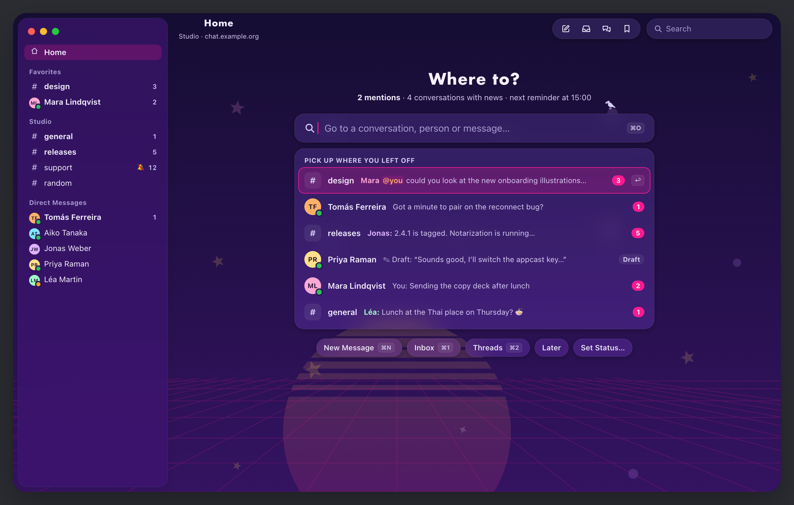
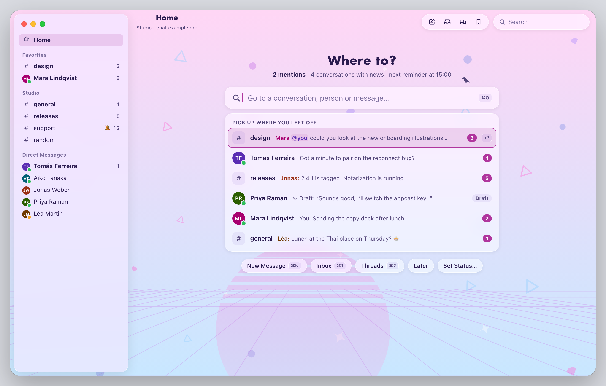

- For: the least to build; fast; works at any window size; calm.
- Against: shows the least; no statistics.

### D. The Afternoon Raven: a daily edition

Home as a front page named for the time of day (The Morning, Afternoon or
Evening Raven): the lead story is what is waiting for you, stories are the
channels with news, and the side column holds who is around, your week in
numbers and what is coming up. Headlines are built from templates ("Mara
Lindqvist mentioned you in # design"); nothing is summarised by AI.

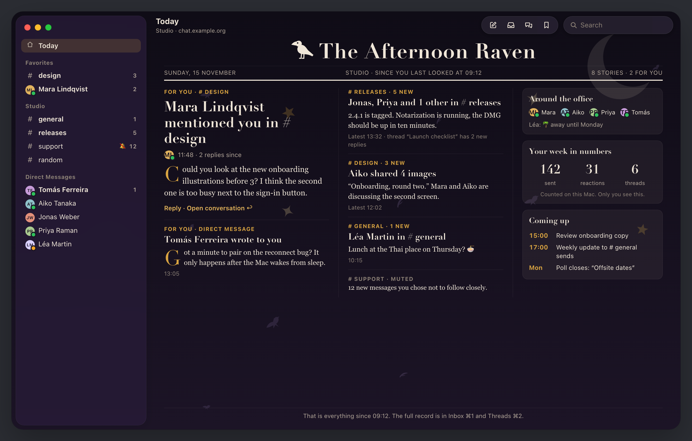
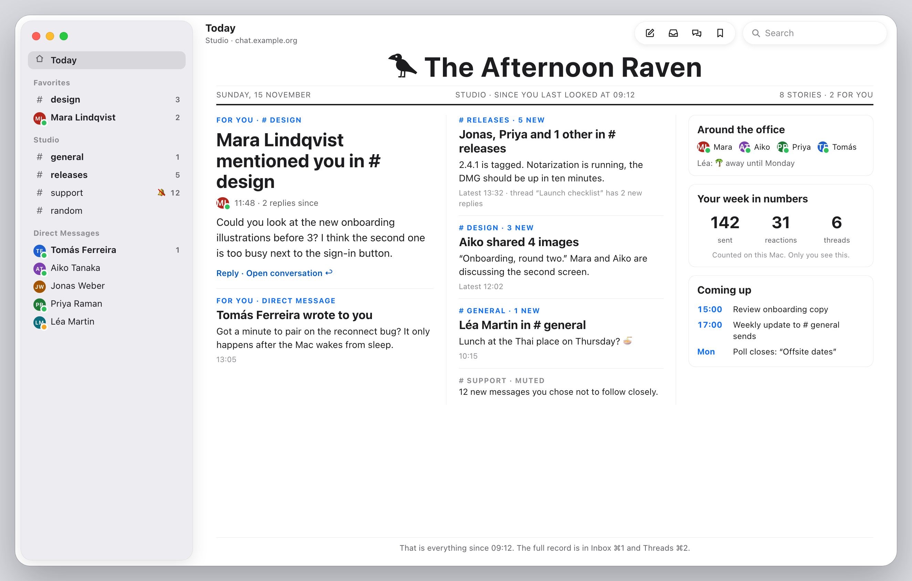

- For: the most character; fits the app's name and its playful side (ravens,
  Wet Ink); good for catching up after a day away.
- Against: a newspaper grid is harder at narrow widths and for VoiceOver
  reading order; template headlines get repetitive on busy days.

## 4. Recommendation

Build **A (Catch Up) with its resting-ravens state** as Home. It does the job
people open the app for, and almost all of its data is already in the session.
Then add B's **Customize Home** with two optional sections, **Your week** and
**You talk with most**, off by default. Keep C's Go To field as the top line of
A if a single field is wanted, and keep D as a later alternative layout.

## 5. Questions for the owner

1. Which direction, or which mix?
2. Retire `Theme.emptyTitle` everywhere, including the theme editor's
   empty-window title field? Home no longer uses it.
3. Personal statistics from Nevermore's own counts going forward (accurate, but
   start empty and miss messages sent from web or mobile), or from the bounded
   history cache (fuller, but partial)?
4. Home as a sidebar row with ⌘0, and should the app open to Home or to the
   last conversation?

## 6. Decision (15 November 2026)

The owner chose **B, Start Page**. What was built, and how the questions in
§5 were settled:

- Home replaces the empty conversation pane whenever an account is open. It
  is the sidebar's first row and Go ▸ Home, **⇧⌘H** (Finder's shortcut for
  Home; ⌘0 is already Make Text Normal Size). Back from Home returns to the
  conversation it was opened from. Launch behaviour is unchanged: a window
  that restores a conversation opens it, any other window opens on Home.
- Modules, all on by default: Favorites, Unread, Later, You Talk with Most,
  Your Week, Threads You Follow, Recent Files. Customize Home (a button below
  the modules, View ▸ Customize Home… and the background's context menu)
  shows, hides and reorders them for every window.
- The per-theme empty titles and empty-window art are retired everywhere,
  including the theme editor's fields. Stored customizations that still
  carry them load without them. Without an account the pane says "No
  Account" in every theme.
- Personal statistics come from the server after all: listing Raven Message
  returns only the caller's own messages, so one request covers every
  device, and nothing needs counting locally. They are labelled "Only you
  see this".
- Not built yet: C's Go To field on Home, and D. "Shared today" became
  Recent Files, the newest files and images from the search index.

## Sources

- Slack: [new design overview](https://slack.com/help/articles/16764236868755-An-overview-of-Slacks-new-design), [unread messages and Catch up](https://slack.com/help/articles/226410907-View-all-your-unread-messages), [Catch up launch](https://www.techradar.com/pro/slacks-new-feature-wants-you-to-swipe-right-on-all-those-unread-alerts), [Slack AI recap](https://www.salesforce.com/news/stories/slack-ai-news-update/)
- Teams: [Discover feed](https://support.microsoft.com/en-US/teams/teams-channels/first-things-to-know-about-teams-discover-feed), [hide Discover](https://www.neowin.net/news/microsoft-finally-allows-users-to-hide-the-discover-feed-in-teams/)
- Zulip: [configure home view](https://zulip.ietf.org/help/configure-home-view), [reading strategies](https://zulip.ietf.org/help/reading-strategies)
- Google Chat: [Home and followed threads](https://workspaceupdates.googleblog.com/2024/07/catch-up-on-followed-threads-from-home-google-chat.html)
- Mattermost: [v7.1 Insights](https://mattermost.com/blog/mattermost-v7-1-is-now-available/), [Insights removed](https://docs.mattermost.com/deploy/legacy-cloud-changelog.html)
- Rocket.Chat: [layout and home page](https://docs.rocket.chat/docs/layout)
- Discord: [Checkpoint 2025](https://discord.com/blog/checkpoint-2025-discord-year-in-review), [Active Now privacy requests](https://support.discord.com/hc/en-us/community/posts/360058196572--Active-Now-Serious-Privacy-Concerns)
- Raven: [find your way around](https://docs.frappe.io/raven/getting-started/find-your-way-around), [`get_channel_list` at v3.2.0](https://github.com/The-Commit-Company/raven/blob/v3.2.0/raven/api/raven_channel.py)
- Safari: [Start Page](https://support.apple.com/en-us/guide/safari/ibrw01514823/16.0/mac/11.0), [sections and background](https://www.macworld.com/article/234642/customize-safari-start-page-macos-big-sur-favorites-background-image-sections-remove-reorganize.html)
- Superhuman: [Inbox Zero images](https://blog.superhuman.com/how-superhuman-chooses-inbox-zero-images/)
- Linear: [Pulse](https://linear.app/changelog/2025-04-16-pulse)
- Basecamp: [new Home](https://updates.37signals.com/post/new-new-home-screen-the-lineup-doors-and-more)
- Notion: [Home](https://www.notion.com/sv/help/home-and-my-tasks)
- Beeper: [inbox tips](https://help.beeper.com/inbox-tips-and-tricks-all-apps-guide)
- Microsoft Productivity Score: [user names removed](https://www.geekwire.com/2020/microsoft-will-remove-user-names-productivity-score-feature-privacy-backlash/)
- GitHub feed: [complaints about "For you"](https://i-programmer.info/news/90-tools/15321-github-users-discontent-with-for-you-feed.html)
- Viva Insights: [privacy considerations](https://learn.microsoft.com/en-us/viva/insights/privacy/privacy-considerations)
