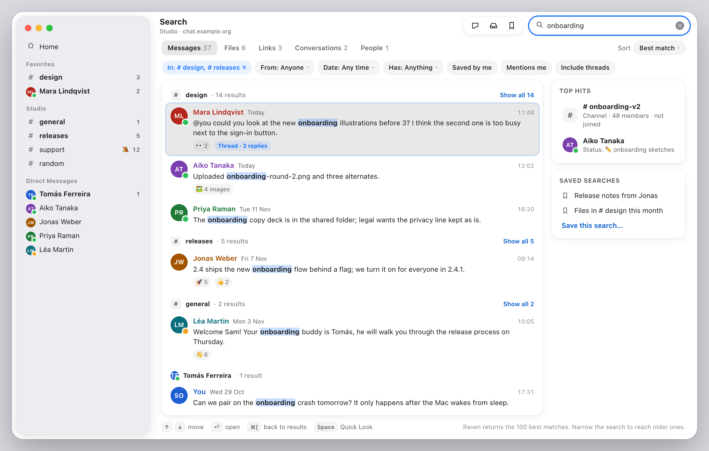
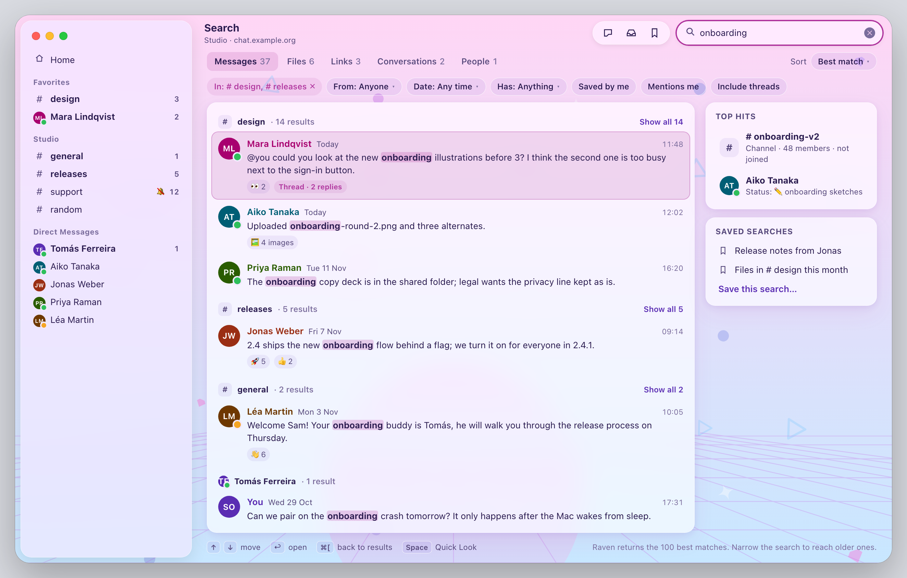
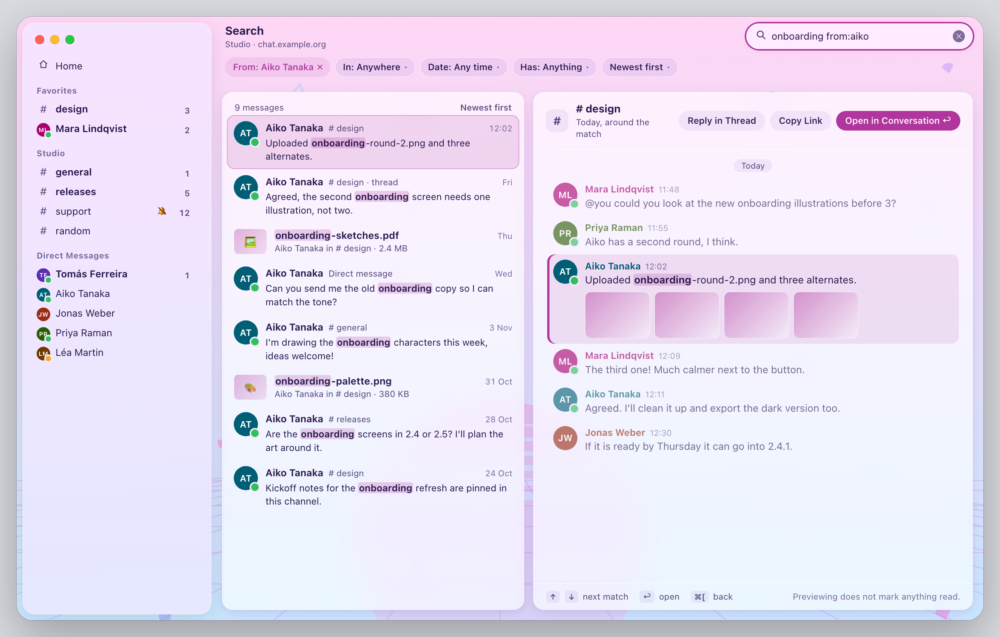
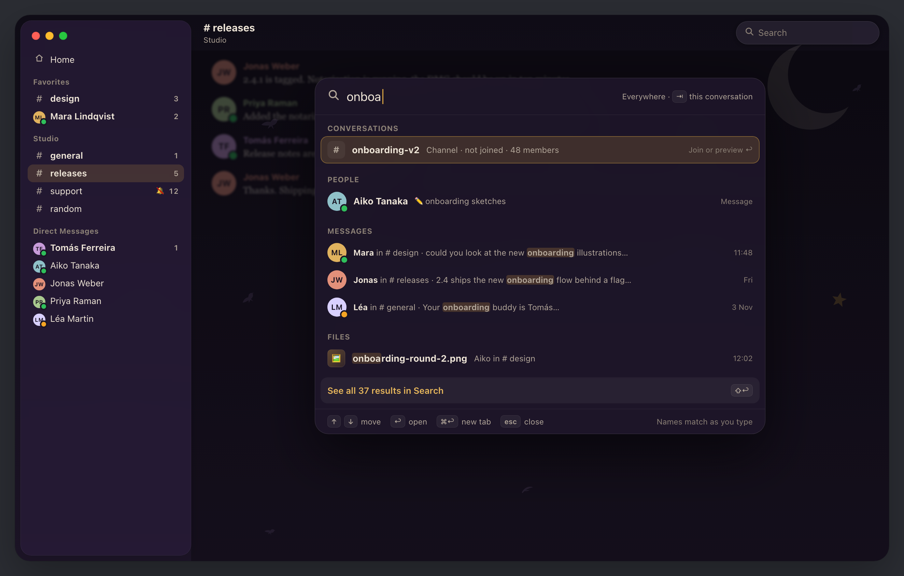

# Search: a results screen worth reading

Status: direction chosen and built, 15 November 2026 (section 6). The
mockups reuse Home's mockup styles (`docs/design/home/mockups`).

Searching Nevermore today takes two windows and gives back a plain table.
This note looks at what other apps do, what Raven can supply for each
result, the rules a results screen must keep, and three design directions
with mockups.

## 1. Today

1. **Start.** Find ▸ Search Messages… (⌥⌘F) focuses the toolbar search
   field. Search This Account… (⇧⌘F) and Search with Filters… open the
   search sheet (`MainMenu.swift:105-107`).
2. **Sheet.** A 680×340 window (`SearchWindow.swift:46-48`) with the query,
   a scope popup (this account, this conversation, workspace channels), a
   kind popup (all, text, files and images, images, polls, links), an
   author field, "Saved by me", "Mentions me" and saved searches.
3. **Results.** Search opens a second window, a `CollectionWindow` table
   titled "Server Search · up to 100 results"
   (`SearchWindow.swift:128-152`). A new search closes the previous
   results. Each row is two lines: text, then `#channel · author · time`
   (`CollectionWindow.swift:167-190`). Return opens the message in its
   conversation.

What goes wrong:

- **Two windows for one task**, and the results window forgets the query
  that made it.
- **Highlight tags may show as text.** With a query, `sqlite_search` puts
  `<mark>` around matched words in `content`. Search rows have no `text`
  field, so the row shows `content` raw (`CollectionWindow.swift:171-173`).
  Not yet seen in a run against a live server.
- **Little to recognise a result by:** no avatar, no file thumbnail, no
  reactions or thread replies. Link rows keep only title, URL and text and
  drop the provider, description and image (`LinkSearch.swift:41-49`).
- **Silent ceiling.** Frappe returns at most 100 matches for a query
  (`MAX_SEARCH_RESULTS` in `frappe/search/sqlite_search.py`) and message
  search has no Load More (`CollectionWindow.swift:404`). The title says
  "up to 100", but nothing says how to reach older matches.
- **The author filter is a raw user ID field** (`SearchWindow.swift:58`).
- **Thread replies are left out** of conversation and workspace scope
  (`SearchCriteria.swift:86-99`); only account scope finds them.
- **No date filter and no sort choice.** Queries come back in Raven's
  relevance order; a blank query lists newest first.

## 2. What other apps do

| App | Where results appear | Grouping and filters | Sort |
| --- | --- | --- | --- |
| Slack | Replaces the conversation in the main window | Type list (messages, files, channels, people) and a Filters panel: in, from, date, has | Most relevant or most recent |
| Microsoft Teams | Suggestions while typing, then a results page | Tabs All, Messages, People, Files; since 2025 also typed operators `from:`, `in:`, `is:`, `with:`, `sent:` | Not documented |
| Discord | Results panel beside the channel | Filters by user, channel, date and `has:` (link, file, image and others) | Newest, oldest or most relevant |
| Zulip | Results replace the message feed | Operators such as `channel:`, `sender:`, `has:`, `is:`; every search is a link | Chronological, like the feed |
| Apple Mail | Results replace the message list | Suggestions (people, subjects, mailboxes) become search tokens | Date, or relevance in Top Hits |
| Linear | Centered quick search palette | Sections by type; type prefixes narrow it | Relevance |

What this teaches:

1. **Results live in the main window.** Every app above keeps them beside
   the sidebar, so opening a result and going back is one step.
2. **Filters are visible and removable.** Chips or tokens show what is
   applied; typed operators are an accelerator, not the only way in.
3. **Type first, then conversation.** Messages, files, people and
   conversations are different jobs; tabs or sections keep them apart.
4. **Recognition beats reading.** Avatars, thumbnails and highlighted
   words let people spot the right hit without opening it.
5. **A quick entry point and a full view.** Teams and Linear show a few
   hits while typing and offer the full list on Return.

## 3. What a result can show

Cost is what one search adds beyond today's single `sqlite_search` call.
Verified against `Sources/`, Raven `raven/api/search.py` and Frappe's
`sqlite_search.py`.

| Item | Where it comes from | Cost |
| --- | --- | --- |
| Highlighted words | `<mark>` in `content`; parsed into attributed ranges, never rendered as HTML | None |
| Author, avatar, status | `author` (normalised to `owner`), the session's directory and avatar cache | None |
| Conversation | `channel_id`, `is_direct_message`, `is_thread_message`, `parent_channel_id` | None |
| Time | `creation` | None |
| File or image | `message_type`, `file_type`, `file_size`, `file_thumbnail`, thumbnail size, `blurhash` | One thumbnail GET per visible row, through the existing attachment loader |
| Pinned, saved | `is_pinned`, `liked_by` | None |
| Reactions, thread replies | Search only says `has_reactions` and `is_thread`; counts need the message | Shown when the message is cached; otherwise left out |
| Link card | `search_links`: `url`, `provider`, `link_preview` title, description, image, site name | None; it is already the Links request |
| Context around a hit | `chat_stream.get_messages` with `base_message` and `update_last_visit: false`, as `Session.swift:435-438` already does | One request, only when a preview is shown |
| Conversations and people | Local match on the session's channel list (unjoined open channels arrive with no `member_id`) and user directory | None |
| Tab counts | Messages: the returned rows. Files: a second `sqlite_search` with `message_type` File or Image. Links: `search_links` | One or two extra requests, run alongside; each count tops out at "100+" |
| Date filter | `filters` accepts `=`, `IN` and `LIKE`, and `LIKE` takes a list ORed together. `creation` LIKE `2026-11-10` is a day, `2026-11-` a month, `2026-` a year; "last 7 days" is seven day patterns | None |
| Older matches | The same query restricted to an earlier month with the date filter; each run returns up to 100 again | One request per step back |
| Newest first for a query | Sorting the returned rows by `creation` | None, but it is the newest of the best 100, and must say so |

Limits that stay: at most 100 results per query, no offset for queries, and
the index is filled by a background job, so a message can take minutes to
become findable. Raven applies its own channel-access filter on
`parent_channel_id` over the client's filters, so "include thread replies"
in a conversation needs the thread IDs: `channel_id IN [conversation,
its threads]`, from the threads in the channel list.

## 4. Rules

- **Searching and previewing mark nothing read.** Previews load with
  `update_last_visit: false`; only opening the conversation counts as
  reading it, as today.
- **Honest about the ceiling.** When a query returns 100, say "Showing the
  100 best matches" and offer the earlier-month step and the filters, never
  a count that implies more were checked.
- **Keyboard first.** ↑/↓ move, Return opens, Space is Quick Look for
  files, ⌘[ returns to the results with the query, filters, selection and
  scroll position kept. Esc leaves search.
- **VoiceOver reads a result as one sentence:** author, conversation,
  time, text, then "3 reactions, thread with 2 replies". Highlights are
  announced as such.
- **Spoilers stay hidden.** Raven's derived `content` masks them; the
  preview must too.
- **No HTML from search is ever rendered.** Snippets are plain text plus
  highlight ranges.

## 5. Three designs

All three keep today's saved searches and filters; they differ in where
results live and how much they show at once. Mockups are HTML in
`mockups/`, rendered with `render.sh`.

### A. Results in the window

Search replaces the conversation pane, as Home does. Tabs for Messages,
Files, Links, Conversations and People; a row of filter chips (In, From,
Date, Has, Saved by me, Mentions me, Include threads); results grouped by
conversation with "Show all N" per group, avatars, highlighted words,
reactions and thread badges. A side column holds Top hits (matching
conversations and people) and saved searches. The footer carries the key
hints and the 100-result note.

- For: one place for every kind of result; grouping by conversation
  answers "where was that said?"; ⌘[ back to results is natural because
  it is the same pane.
- Against: grouping hides strict date order (a sort switch restores it);
  the most work of the three.

### B. Results with a preview

A list of hits on the left, newest first; the selected hit shows in a
preview on the right with a few messages around it, and Reply in Thread,
Copy Link and Open in Conversation. "Previewing does not mark anything
read" sits under the preview.

- For: you can check several hits without leaving search; strong for
  "which of these five was it?".
- Against: needs a wide window; one context request per selected hit; the
  list has less room for grouping and tabs.

### C. Quick search palette

A centered panel over the conversation, like Spotlight or Linear: sections
for Conversations, People, Messages and Files as you type, a scope switch
(everywhere, or ⇥ for this conversation), and "See all 37 results in
Search ⇧↩" to open the full view.

- For: fastest way to jump somewhere; replaces both ⌘O-style navigation
  and short searches with one field.
- Against: only a handful of hits fit; it still needs A or B for real
  searching.

## 6. Decision

Chosen by the owner on 15 November 2026:

1. **Layout: A with B's preview.** Results replace the conversation pane,
   with A's tabs and filter chips. The right column shows Top hits
   (matching conversations and people) and saved searches while no
   result is selected, and the preview of the selected result once one
   is. C, the quick palette, may follow later as an entry point whose ⇧↩
   ends in this screen.
2. **Grouped by conversation** by default, with "Show all N" per group
   and a sort switch for strict date order.
3. **Search as you type**, after a short pause. A new keystroke cancels
   the request in flight, so only the latest query's results show.
4. **Thread replies included** by default for conversation scope, with
   an Include threads chip to turn them off.
5. **The search sheet is retired.** Search This Account… (⇧⌘F) and
   Search with Filters… open the results screen with the chips; saved
   searches move to the right column and a menu. The separate results
   window goes too.

## Sources

- Slack: [Search in Slack](https://slack.com/help/articles/202528808)
- Microsoft Teams: [new search results experience](https://techcommunity.microsoft.com/blog/microsoftteamsblog/new-and-improved-search-results-experience-on-microsoft-teams/3035064), [search operators, MC1130388](https://mc.merill.net/message/MC1130388)
- Discord: [search help](https://support.discord.com/hc/en-us/articles/115000468588)
- Zulip: [search for messages](https://zulip.com/help/search-for-messages)
- Apple Mail: [search for email](https://support.apple.com/guide/mail/search-for-email-mlhlp1022/mac)
- Linear: [search](https://linear.app/docs/search)
- Frappe: [`sqlite_search.py`](https://github.com/frappe/frappe/blob/develop/frappe/search/sqlite_search.py) (`MAX_SEARCH_RESULTS = 100`), [SQLite Search docs](https://docs.frappe.io/framework/sqlite-search)
- Raven: [`search.py` at v3.2.0](https://github.com/The-Commit-Company/raven/blob/v3.2.0/raven/api/search.py)
